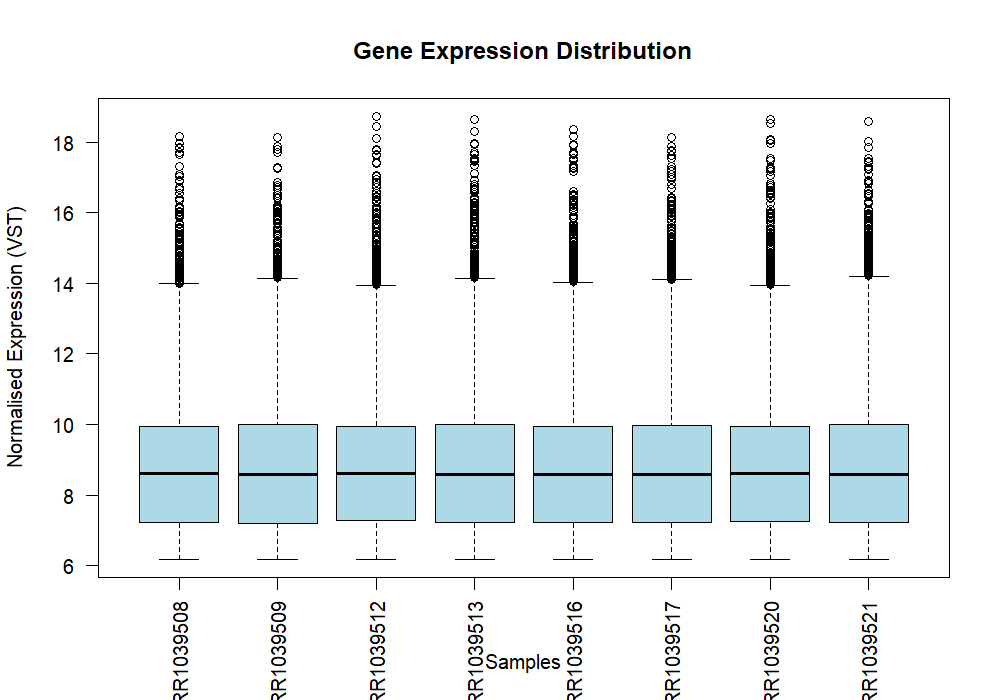
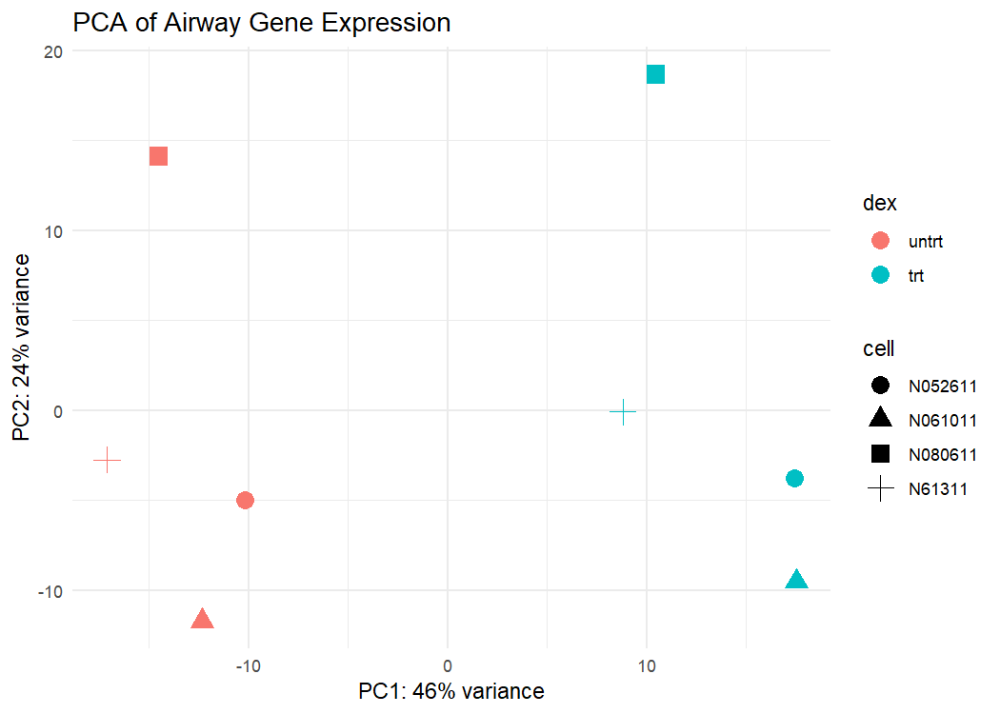
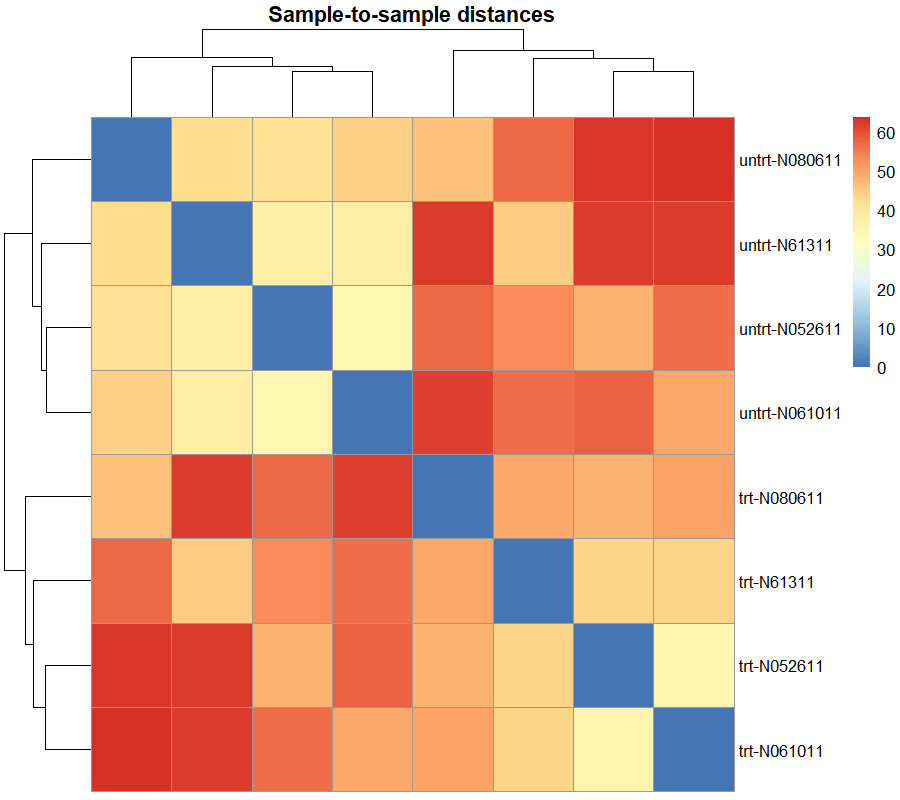
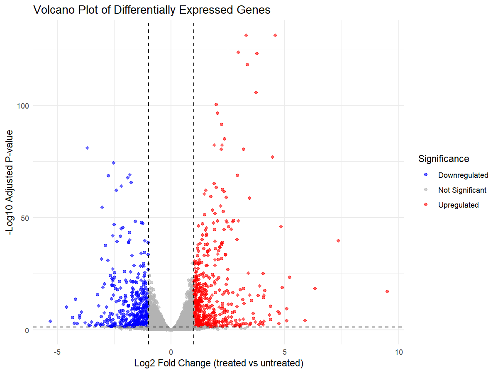
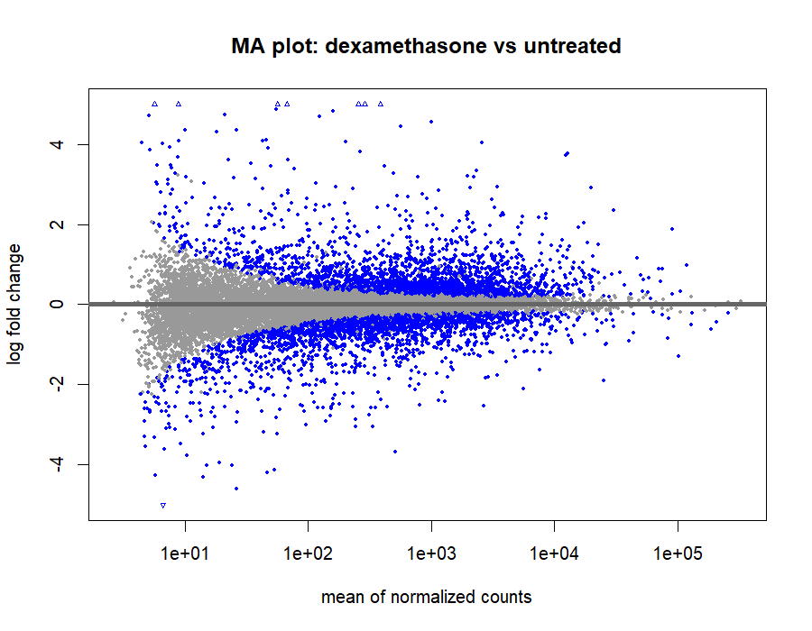
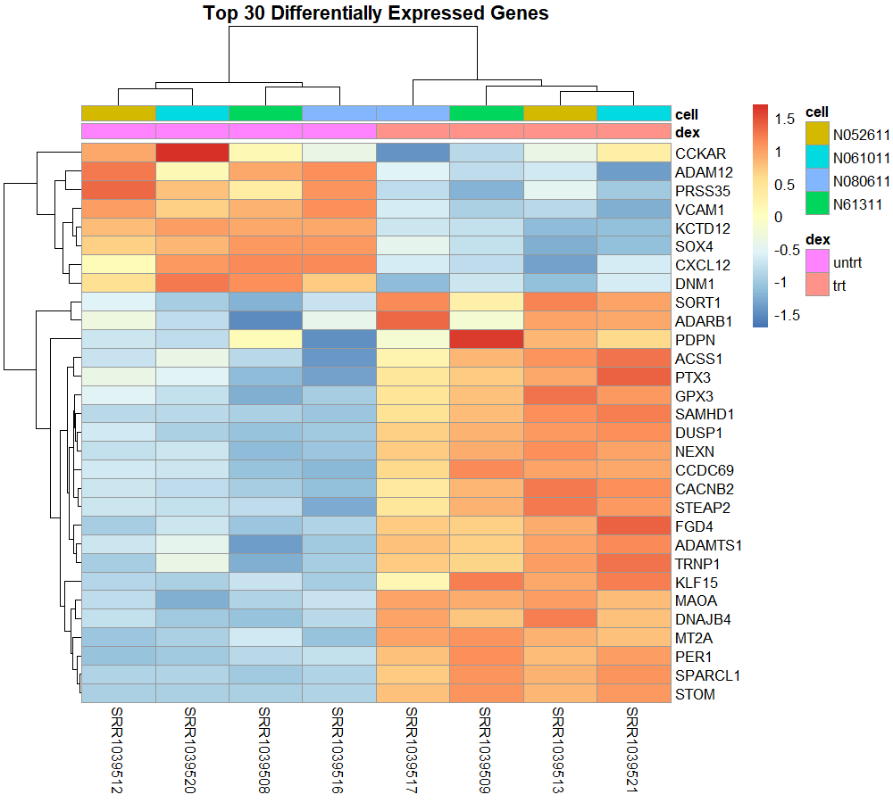

# Analysis of Gene Expression Changes in Human Airway Cells After Dexamethasone Treatment Using RNA-Seq Data

Bioinformatics ICA 03 
Registration number: **2021/ICT/112**

## Research question
How does dexamethasone treatment affect gene expression in human airway smooth muscle cells?

## Aim
Identify genes that show significant expression changes after dexamethasone treatment.

## Dataset
Bioconductor `airway` package (Himes et al., 2014): RNA-seq of human airway smooth muscle cells,
8 samples from 4 donors, treated (dexamethasone) vs untreated.

## Tools
R, RStudio, airway, DESeq2, ggplot2, dplyr, pheatmap, org.Hs.eg.db.

## Project structure
```
code/       R scripts (run in numeric order, or run code/analysis.R)
results/    CSV tables (and figures/ for plots)
data/       (dataset is loaded directly from the airway package)
```

# Abstract

This project investigates the effects of dexamethasone treatment on gene expression in human airway smooth muscle cells using RNA-sequencing data from the Bioconductor `airway` package. Data preprocessing, quality control, exploratory analysis and differential expression analysis with DESeq2 were performed in R. Genes with an adjusted p-value below 0.05 and an absolute log2 fold change above 1 were considered differentially expressed. PCA, volcano plots and heatmaps were used to present the findings. The study aims to identify genes affected by dexamethasone and improve understanding of its biological effects on human airway cells.

# Introduction

## Background
Gene expression is the process by which information in DNA is used to produce functional products such as proteins. RNA sequencing (RNA-seq) measures gene expression levels in biological samples. Dexamethasone is a corticosteroid used to reduce inflammation and treat a range of medical conditions, including airway diseases. Studying gene expression changes after treatment helps researchers understand how cells respond to the drug.

## Problem, aim and objectives
Medicines change the activity of many genes, but identifying which genes increase or decrease after treatment requires systematic analysis. The aim of this project is to identify and analyse gene expression changes in human airway smooth muscle cells following dexamethasone treatment. The objectives are to (1) obtain public RNA-seq data, (2) import and preprocess it in R, (3) explore it, (4) identify differentially expressed genes, (5) visualise the changes and (6) interpret their biological meaning.

## Hypotheses
- **H0:** Dexamethasone treatment does not produce significant changes in gene expression.
- **H1:** Dexamethasone treatment produces significant changes in the expression of one or more genes.

# Data

The `airway` dataset (Himes et al., 2014) contains RNA-seq counts from human airway smooth muscle cells from four donors, each sample either untreated or treated with dexamethasone, giving eight samples in total. The data are a gene-by-sample count matrix with sample information including the treatment (`dex`) and donor/cell line (`cell`).

```{r samples}
knitr::kable(read.csv("results/sample_information.csv"), caption = "Sample information")
```

**Ethics.** This is an existing public research dataset. No new participants were recruited, no personally identifying information was used, and the original source is acknowledged.

# Methods

The analysis was run in R using `airway`, `DESeq2`, `ggplot2`, `dplyr` and `pheatmap`. Genes were retained if they had at least 10 reads in at least two samples. Counts were transformed with the variance-stabilising transformation (VST) for visualisation. Differential expression used DESeq2 with the design `~ cell + dex`, which accounts for donor differences when comparing treated and untreated samples. Genes were called significant when the adjusted p-value (Benjamini–Hochberg) was below 0.05 and the absolute log2 fold change exceeded 1. A positive log2 fold change means higher expression in treated samples. These thresholds are analysis choices. All code is in the `code/` folder.

# Results

## Preprocessing
After filtering, `r n_tested` genes with valid adjusted p-values were tested for differential expression.

## Expression distribution


The boxplot illustrates the distribution of normalized gene expression values (VST) across all eight sequenced samples. The median expression levels and overall data distributions are consistent and well-aligned across every sample. This indicates that the normalization process was successful, removing technical variations and making the samples directly comparable for downstream differential expression analysis

## PCA


The Principal Component Analysis (PCA) plot demonstrates clear grouping of samples based on Dexamethasone treatment.

    PC1 (explaining 46% of the variance) distinctly separates the treated (trt) samples on the right from the untreated (untrt) samples on the left. This indicates that the Dexamethasone treatment is the primary source of variation in gene expression.

    PC2 (explaining 24% of the variance) captures variation across different cell lines.
    Overall, the tight clustering within treatment groups confirms high reproducibility and a strong biological response to the treatment.

*Interpretation:* The first two principal components explain `r round(100*attr(pca, "percentVar")[1])`% and `r round(100*attr(pca, "percentVar")[2])`% ... (see figure). WRITE HERE whether treated and untreated samples separate, and whether donors (shapes) cluster.



## Differential expression
DESeq2 identified **`r n_sig`** significantly differentially expressed genes, of which **`r n_up`** were upregulated and **`r n_down`** were downregulated after dexamethasone treatment.

```{r top}
knitr::kable(head(sig[, c("gene_id", "symbol", "baseMean", "log2FoldChange", "padj")], 10),
             digits = 3, caption = "Ten most significant genes")
```
The sample-to-sample distance heatmap displays the Euclidean distances calculated from the transformed expression data. Lower distances (darker blue) indicate high similarity between samples. The hierarchical clustering clearly divides the samples into two main clusters corresponding to the treatment condition (trt vs untrt). Within each treatment group, samples cluster closely together, further verifying strong consistency and minimal batch or technical noise among biological replicates.


## Volcano plot


*Interpretation:* The volcano plot summarizes the overall differential gene expression between treated and untreated conditions, plotting $-\log_{10}$ adjusted p-values against $\log_{2}$ fold changes.Genes significantly Upregulated by the treatment are highlighted in red on the right.Genes significantly Downregulated are highlighted in blue on the left.Non-significant genes remain in grey around the center.The large number of genes passing the significance thresholds indicates that Dexamethasone induces a substantial transcriptional response in the airway cells.



## Heatmap


*Interpretation:*The heatmap displays the expression patterns of the top 30 most significantly differentially expressed genes across all eight samples. Each row represents a gene, and each column represents a sample, with color intensities reflecting relative expression levels (ranging from blue for low expression to red for high expression). The hierarchical clustering tree at the top clearly divides the samples into two main groups corresponding to the treatment condition (untrt vs trt). This distinct grouping demonstrates that Dexamethasone treatment induces a clear and consistent shift in gene expression, where specific subsets of genes are systematically upregulated while others are downregulated
# Discussion

WRITE HERE (about 300–500 words): state whether you reject H0; discuss the top genes in the table above and what is known about them in glucocorticoid response (check the gene functions and cite sources, e.g. Himes et al., 2014, who reported CRISPLD2 as a glucocorticoid-responsive gene); compare with the literature; explain what the PCA and heatmap show about donor effects.

## Limitations
1. Only eight samples are included.
2. Only four donors are represented, so results may not generalise to all populations.
3. Changes in gene expression do not necessarily mean changes in protein activity.
4. Findings need experimental validation.

# Conclusion

This project used RNA-seq data and DESeq2 to identify genes whose expression changes in human airway smooth muscle cells after dexamethasone treatment. WRITE HERE a 3–4 sentence summary using the actual numbers above.

# Reproducibility

All scripts, results and figures are in the public GitHub repository. Run `code/analysis.R` from the project root, then knit this file.

```{r session}
sessionInfo()
```

# References

1. Himes, B. E., et al. (2014). RNA-Seq transcriptome profiling identifies CRISPLD2 as a glucocorticoid responsive gene that modulates cytokine function in airway smooth muscle cells. *PLoS ONE*, 9(6), e99625. https://doi.org/10.1371/journal.pone.0099625
2. Love, M. I., Huber, W., & Anders, S. (2014). Moderated estimation of fold change and dispersion for RNA-seq data with DESeq2. *Genome Biology*, 15, 550. https://doi.org/10.1186/s13059-014-0550-8
3. Bioconductor. airway: RNA-seq analysis data. https://bioconductor.org/packages/airway/
4. R Core Team. The R Project for Statistical Computing. https://www.r-project.org/


## How to reproduce
1. Open the project folder in RStudio and set it as the working directory.
2. Run `source("code/analysis.R")` (installs nothing; install packages first with `code/00_install_packages.R`).
3. Render `report.Rmd` to HTML.

## Status
Project set up. Analysis and report to follow.
